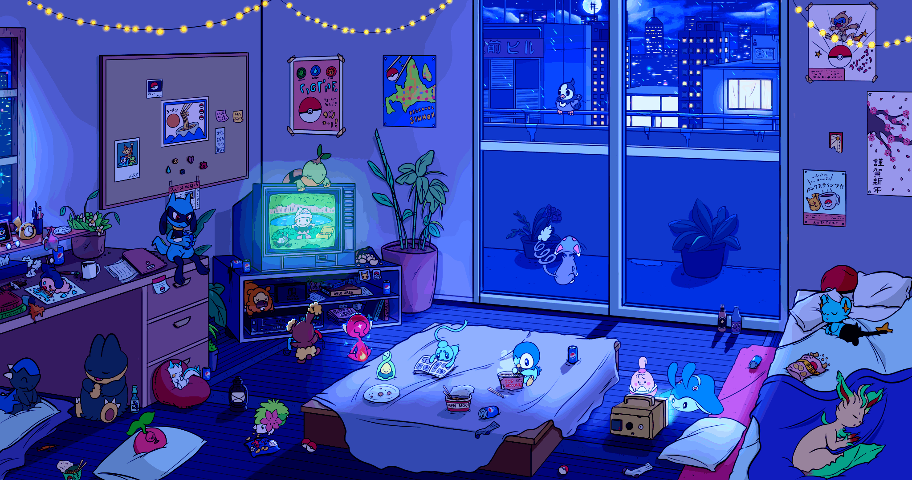

<h3>Aspiring Software Developer</h3>

  
  

<!-- Pixel art banner: upload your own image to assets/pixel-room.gif -->

---

## 🌱 A Little About Me

Hey! I'm Hiten, Computer Science student.

- 🎓 Pursuing B.Tech in Computer Science.
- 💻 Exploring programming and software development.
- 🌱 Currently learning C++, DSA and Python.
- 🚀 Interested in building projects and learning new technologies.
- ✨ Believe in learning by building.

**My motto:** Learn → Build → Improve → Repeat.

---

## 💻 Languages & Tools

---

## 🚀 Things I've Built

| Project | Description | Language |
|---|---|---|
| [DSA with C++](https://github.com/HITENB05/DSA-with-Cpp) | DSA practice and problem solving | C++ |
| [Hangman Game](https://github.com/HITENB05/CodeAlpha_HangmanGame) | Classic word guessing game | Python |
| [Web Development](https://github.com/HITENB05/WEB-DEVELOPMENT) | Learning and practising web development | HTML/CSS |

---

## 📊 GitHub at a Glance

 

---

## 🌐 Find Me Around The Web

---

### Thanks for stopping by! ✨

